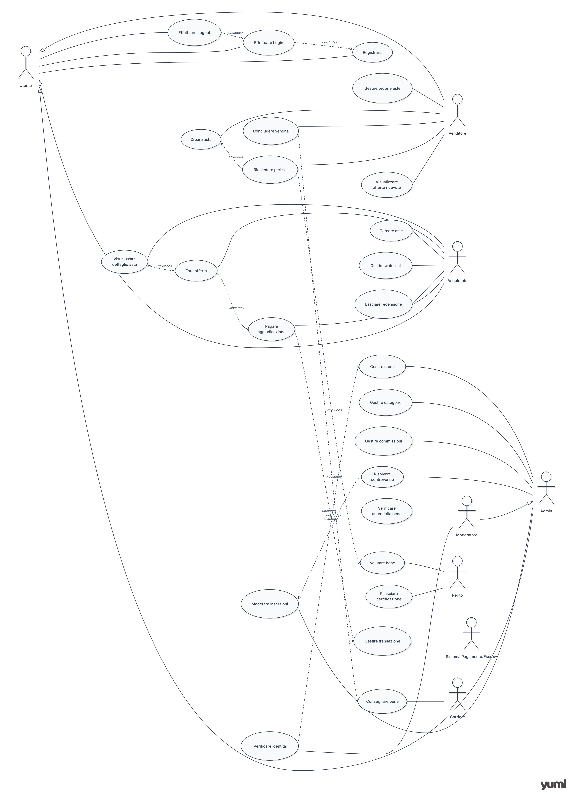

# ProgettoYaz5IE
# ASTRA

**Tagline:** *"Il valore lo decide il mercato. Tu scegli cosa mettere all'asta."*

##  Descrizione del Progetto

**ASTRA** è una piattaforma web di aste digitali che mette in contatto venditori e acquirenti di beni reali — come immobili, opere d'arte, oggetti da collezione, auto d'epoca e beni di lusso. Attraverso un sistema di aste trasparenti e dinamiche, il prezzo di un bene emerge dalla domanda reale del mercato. Il venditore può valorizzare al meglio i propri beni, mentre l'acquirente ha accesso a nuove opportunità di acquisto in un ambiente sicuro e regolamentato.

##  Problema

I mercati tradizionali (agenzie immobiliari, gallerie d'arte, mercatini dell'usato) sono spesso lenti, opachi e con prezzi fissati o negoziati in modo poco trasparente. Chi vende fatica a raggiungere un pubblico ampio e a ottenere il giusto valore; chi compra non ha sempre visibilità sul reale valore di mercato di un bene.

##  Target

Collezionisti, appassionati d'arte, investitori immobiliari, cacciatori di affari, giovani adulti interessati a oggetti unici, privati che desiderano vendere beni di valore, gallerie, agenzie immobiliari e case d'asta.

##  Competitors

eBay, Catawiki, Christie's, Sotheby's.

---

## Funzionalità

### 1. Registrazione e Accesso
- Registrazione tramite nome, email e password
- Login e logout
- Modifica dei dati dell'account
- Eliminazione dell'account

### 2. Gestione delle Inserzioni (Venditore)
- Creazione di una nuova asta (foto, descrizione, categoria, prezzo di partenza, durata, prezzo di riserva)
- Modifica delle proprie inserzioni
- Annullamento di un'asta
- Visualizzazione delle proprie aste attive e concluse

### 3. Ricerca e Visualizzazione (Acquirente)
- Ricerca avanzata per categoria (Immobiliare, Arte, Collezionismo, Lusso, Elettronica, Altro), prezzo, località
- Visualizzazione del dettaglio dell'asta (foto, descrizione, tempo rimanente, offerte attuali)
- Utilizzo di filtri di ricerca rapidi


### 4. Sistema di Offerte (Aste)
- Invio di un'offerta con importo superiore all'offerta minima corrente
- Visualizzazione in tempo reale del countdown e delle offerte
- Notifiche automatiche quando si viene superati in un'offerta o quando un'asta a cui si è interessati sta per scadere
- Aggiudicazione automatica al miglior offerente alla scadenza

### 5. Pagamenti e Transazioni
- Pagamento sicuro dell'aggiudicazione tramite sistema Escrow (i fondi vengono trattenuti fino alla consegna)
- Gestione dei rimborsi in caso di problemi
- Visualizzazione dello storico delle transazioni

### 6. Perizie e Verifiche
- Richiesta di perizia per beni di alto valore (arte, gioielli, immobili)
- Validazione e certificazione dell'autenticità del bene da parte di esperti

### 7. Logistica e Consegna
- Tracciamento della spedizione per i beni fisici
- Supporto notarile per il trasferimento di proprietà degli immobili

### 8. Recensioni e Feedback
- Possibilità di lasciare un voto numerico e un commento post-transazione
- Visualizzazione del feed delle recensioni e calcolo della valutazione media per venditori e acquirenti

### 9. Pannello Amministratore (Admin)
- Monitoraggio globale degli utenti e delle aste
- Controllo e gestione degli account (sospensione o eliminazione)
- Moderazione delle inserzioni (rimozione di contenuti illeciti)
- Gestione e risoluzione delle segnalazioni degli utenti
- Supervisione delle commissioni e dei pagamenti

### 10. Sicurezza e Controlli
- Validazione e sanificazione dei dati in input
- Cifratura e memorizzazione sicura delle password
- Controllo degli accessi basato sui ruoli (RBAC): separazione tra Venditori, Acquirenti, Moderatori, Admin
- Gestione centralizzata dei messaggi di errore

---

##  Classificazione dei Requisiti

### Requisiti Funzionali
| Requisito | Tipo |
| :--- | :--- |
| Registrazione, login, logout e gestione account | Funzionale |
| Creazione, modifica e annullamento di un'asta | Funzionale |
| Ricerca e visualizzazione delle aste | Funzionale |
| Invio di un'offerta | Funzionale |
| Pagamento dell'aggiudicazione | Funzionale |
| Ricezione di notifiche per offerte e scadenze | Funzionale |
| Gestione della Watchlist | Funzionale |
| Inserimento di un voto e commento post-transazione | Funzionale |
| Visualizzazione delle recensioni e valutazione media | Funzionale |
| Gestione degli account e moderazione (Admin) | Funzionale |

### Requisiti di Dominio
| Requisito | Tipo |
| :--- | :--- |
| Impostazione del prezzo di partenza, prezzo di riserva e durata dell'asta | Di dominio |
| Calcolo automatico dell'offerta minima successiva | Di dominio |
| Verifica dell'autenticità di un bene (Perito) | Di dominio |
| Calcolo del countdown e chiusura automatica dell'asta | Di dominio |
| Applicazione delle commissioni sulla vendita | Di dominio |

### Requisiti Non Funzionali
| Requisito | Tipo |
| :--- | :--- |
| Controllo e validazione dei dati inseriti | Non funzionale |
| Password memorizzate in modo sicuro | Non funzionale |
| Protezione dei dati degli utenti | Non funzionale |
| Separazione dei permessi tra i ruoli | Non funzionale |
| Gestione dei messaggi di errore | Non funzionale |
| Scalabilità del sistema per gestire aste con molti utenti in tempo reale | Non funzionale |

---

##  Attori

- **Venditore:** Utilizza la piattaforma per creare aste, gestire i propri beni e concludere le vendite.
- **Acquirente / Offerente:** Sfoglia le aste, fa offerte, monitora i preferiti e paga le aggiudicazioni.
- **Admin / Moderatore:** Gestisce gli utenti, modera le inserzioni, risolve le controversie e supervisiona le transazioni.
- **Perito / Esperto:** Valuta i beni di alto valore e rilascia certificazioni di autenticità.
- **Sistema di Pagamento / Escrow:** Gestisce le transazioni in modo sicuro trattenendo i fondi fino alla consegna.
- **Corriere / Logistica:** Si occupa della consegna dei beni fisici.


---

##  User Stories


### Gestione Account & Aste (Venditore)

- **Registrazione e login:** Come venditore, voglio registrarmi e fare il login, così posso accedere alla piattaforma in modo sicuro.
- **Creazione asta:** Come venditore, voglio creare una nuova asta con foto, descrizione, prezzo di partenza e durata, così posso mettere in vendita il mio bene.
- **Gestione aste:** Come venditore, voglio modificare o annullare le mie aste, così posso tenere aggiornate le mie inserzioni.
- **Visualizzazione offerte:** Come venditore, voglio vedere le offerte ricevute in tempo reale, così posso monitorare l'interesse per il mio bene.
- **Conclusione vendita:** Come venditore, voglio concludere la vendita alla fine dell'asta, così posso finalizzare la transazione con chi ha offerto di più.

### Ricerca, Offerte & Acquisti (Acquirente)

- **Ricerca aste:** Come acquirente, voglio cercare le aste per categoria, prezzo e località, così posso trovare gli oggetti che mi interessano.
- **Filtri di ricerca:** Come acquirente, voglio filtrare le aste per categoria e fascia di prezzo, così posso restringere la ricerca velocemente.
- **Visualizzazione dettaglio asta:** Come acquirente, voglio vedere i dettagli di un'asta (foto, descrizione, countdown, offerte attuali), così posso valutare il bene.
- **Fare un'offerta:** Come acquirente, voglio fare un'offerta più alta di quella attuale, così posso provare a vincere l'asta.
- **Pagamento:** Come acquirente, voglio pagare in modo sicuro l'asta che ho vinto, così posso ricevere il bene.
- **Recensioni:** Come acquirente, voglio lasciare un voto e un commento dopo la transazione, così posso dare un feedback al venditore.

### Pannello di Amministrazione (Admin / Moderatore)

- **Gestione utenti:** Come amministratore, voglio vedere e gestire gli utenti registrati, così posso controllare chi usa la piattaforma.
- **Moderazione inserzioni:** Come amministratore, voglio moderare le inserzioni e rimuovere i contenuti inappropriati, così la piattaforma resta sicura e a norma.
- **Gestione controversie:** Come amministratore, voglio risolvere le controversie tra acquirenti e venditori, così posso gestire i problemi in modo equo.
- **Gestione commissioni:** Come amministratore, voglio gestire le commissioni e i pagamenti della piattaforma, così il modello di business funziona correttamente.

### Servizi Esterni (Perito, Corriere)

- **Valutazione bene:** Come perito, voglio valutare i beni di alto valore e rilasciare certificazioni, così gli acquirenti possono fidarsi dell'autenticità dell'oggetto.
- **Consegna bene:** Come corriere, voglio consegnare i beni fisici all'acquirente, così la transazione può essere completata.

---

---

## Diagramma grafico UML

<p align="center">
  
</p>

##  Diagramma dei Casi d'Uso (UML)

```yuml

[Utente]
[Venditore]^[Utente]
[Acquirente]^[Utente]
[Admin]^[Utente]
[Moderatore]^[Admin]
[Perito]
[Sistema Pagamento/Escrow]
[Corriere]


[Utente]-(Registrarsi)
[Utente]-(Effettuare Login)
[Utente]-(Effettuare Logout)
(Effettuare Logout)>(Effettuare Login)
(Effettuare Login)>(Registrarsi)


[Venditore]-(Creare asta)
[Venditore]-(Gestire proprie aste)
[Venditore]-(Visualizzare offerte ricevute)
[Venditore]-(Concludere vendita)
[Venditore]-(Richiedere perizia)


[Acquirente]-(Cercare aste)
[Acquirente]-(Visualizzare dettaglio asta)
[Acquirente]-(Fare offerta)
[Acquirente]-(Gestire watchlist)
[Acquirente]-(Pagare aggiudicazione)
[Acquirente]-(Lasciare recensione)


[Admin]-(Gestire utenti)
[Admin]-(Gestire categorie)
[Admin]-(Gestire commissioni)
[Admin]-(Moderare inserzioni)
[Admin]-(Risolvere controversie)
[Moderatore]-(Verificare identità)
[Moderatore]-(Verificare autenticità bene)


[Perito]-(Valutare bene)
[Perito]-(Rilasciare certificazione)
[Sistema Pagamento/Escrow]-(Gestire transazione)
[Corriere]-(Consegnare bene)


(Creare asta)<(Richiedere perizia)
(Richiedere perizia)>(Valutare bene)

(Visualizzare dettaglio asta)<(Fare offerta)
(Fare offerta)>(Pagare aggiudicazione)
(Pagare aggiudicazione)>(Gestire transazione)

(Concludere vendita)>(Consegnare bene)


(Moderare inserzioni)<(Risolvere controversie)
(Verificare identità)>(Gestire utenti)


